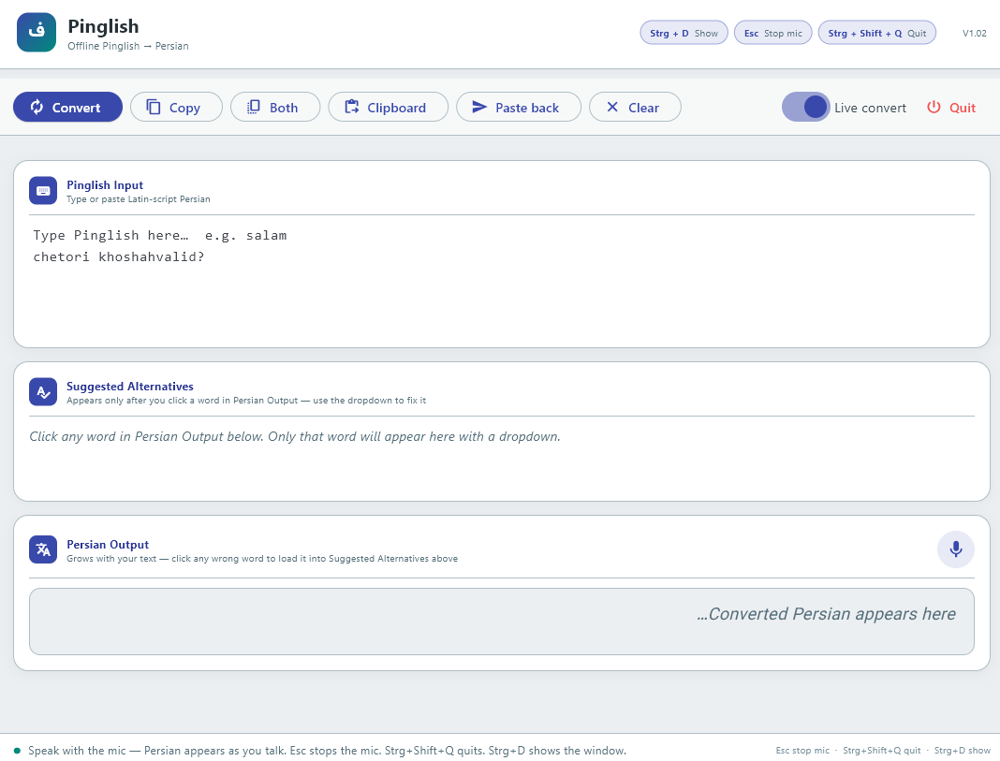
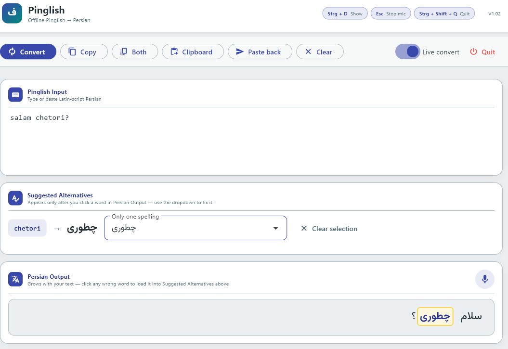
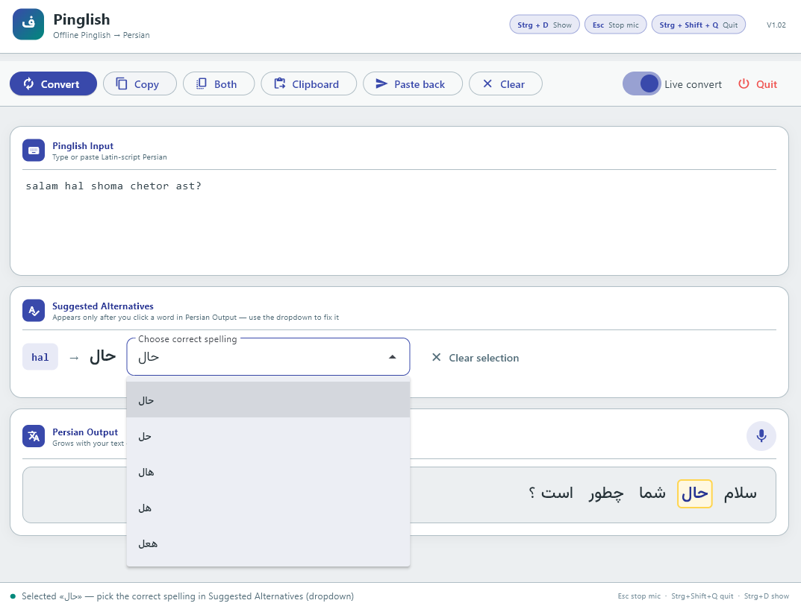

<div align="center">


# Pinglish

[English](README.md) | [فارسی](README.fa.md) | **Deutsch**

**Persisch in lateinischen Buchstaben tippen oder einfach sprechen – und korrekte persische Schrift erhalten.**

Eine Windows-Desktop-App, die Pinglish / Finglish (`salam chetori?`) schon
beim Tippen in persische Schrift (`سلام چطوری؟`) umwandelt, jedes Wort aus einer
Liste alternativer Schreibweisen korrigieren lässt und gesprochenes Persisch
live in Text verwandelt.


</div>

---

<a id="download"></a>
## Download

<a href="https://apps.microsoft.com/detail/9PLPN1KMX104"></a>

**Empfohlen: [Pinglish im Microsoft Store](https://apps.microsoft.com/detail/9PLPN1KMX104)** (Windows 10/11, 64 Bit).
Installation mit einem Klick, ohne Sicherheitswarnung, und die App aktualisiert sich selbst.

Oder das Installationsprogramm von GitHub herunterladen:
**[⬇ Pinglish-Setup-&lt;version&gt;.exe](https://github.com/MindDriverTUWIEN/Pinglish/releases/latest)**.
Ausführen, durch die Installation klicken und Pinglish über das Startmenü öffnen.

Python oder andere Software wird nicht benötigt. Einzelheiten unter
[Installation](#installation).

<a id="screenshots"></a>
## Bildschirmfotos

<p align="center">
  
  <br><em>Die App nach dem Start: Pinglish Input, Suggested Alternatives und Persian Output.</em>
</p>

<p align="center">
  
  <br><em>Wer <code>salam chetori?</code> tippt, erhält sofort <code>سلام چطوری؟</code>. Ein Klick auf ein Wort zeigt seine Schreibweisen.</em>
</p>

<p align="center">
  
  <br><em>Mit dem Mikrofon gesprochen: <code>salam hal shoma chetor ast?</code> → <code>سلام حال شما چطور است؟</code>, mit geöffneten Alternativen für حال.</em>
</p>

## Inhalt

- [Download](#download)
- [Bildschirmfotos](#screenshots)
- [Funktionen](#features)
- [Voraussetzungen](#requirements)
- [Installation](#installation)
- [Bedienung](#usage)
- [Sprach-Schlüssel](#speech-key)
- [Eigenen Google-Cloud-Schlüssel verwenden](#own-cloud-key)
- [Einstellungen und Datendateien](#data-files)
- [So funktioniert es](#how-it-works)
- [Projektaufbau](#project-structure)
- [Wörterbuch verbessern](#dictionary)
- [Installationsprogramm erstellen](#building)
- [Fehlerbehebung](#troubleshooting)
- [Datenschutz](#privacy)
- [Richtlinie zur Code-Signierung](#code-signing-policy)
- [Mitwirken](#contributing)
- [Danksagungen](#credits)
- [Lizenz](#license)

<a id="features"></a>
## Funktionen

- **Live-Umwandlung.** Persian Output aktualisiert sich bei jedem Tastendruck.
- **Vorgeschlagene Alternativen.** Auf ein Wort in Persian Output klicken, um
  andere Schreibweisen zu sehen und die richtige auszuwählen. Die Wahl wird ab
  dann gespeichert.
- **Persische Satzzeichen.** Aus `?` `,` `;` werden im persischen Text `؟` `،` `؛`;
  Zahlen wie `1,000` behalten ihr Komma.
- **Sprache zu Text (fa-IR).** Mikrofon drücken und Persisch sprechen. Die
  Wörter erscheinen schon während des Sprechens, und jede Phrase wird durch das
  endgültige Ergebnis der Spracherkennung ersetzt.
  - Das Gesprochene wird außerdem als Pinglish in Pinglish Input geschrieben
    (`این هدفونی که گرفتی خیلی گرونه` → `in hedfooni ke gerefti kheili gerooneh`),
    sodass man danach einfach weitertippen kann.
  - Gesprochene Satzzeichen: **علامت سوال** für `؟`, **علامت تعجب** für `!`,
    **نقطه** für `.` und **فاصله** für ein Leerzeichen.
- **Zwischenablage.** Den Inhalt der Zwischenablage umwandeln, den persischen
  Text (oder beide Texte) kopieren oder das Ergebnis direkt in die zuvor
  benutzte App einfügen.
- **Läuft im Hintergrund.** Das Schließen des Fensters blendet es nur in den
  Infobereich (Taskleiste) aus. Ein globales Tastenkürzel holt es aus jedem
  Programm zurück.
- **Taskleistentauglich.** Lässt sich als *Pinglish* mit eigenem Symbol anheften.

<a id="requirements"></a>
## Voraussetzungen

- Windows 10 oder 11, 64 Bit (die App nutzt WASAPI-Audio und Win32-Fenster-APIs)
- Nur für die Spracheingabe: ein Mikrofon und eine Internetverbindung
- Nur für den Start aus dem Quellcode: Python 3.11 oder neuer

<a id="installation"></a>
## Installation

### Für Anwender: Microsoft Store (empfohlen)

1. [Pinglish im Microsoft Store](https://apps.microsoft.com/detail/9PLPN1KMX104) öffnen und auf **Herunterladen** (oder **Installieren**) klicken.
2. **Pinglish** über das Startmenü starten.

Die Store-Version ist von Microsoft signiert, Windows zeigt daher keine Warnung,
und sie aktualisiert sich automatisch. Vor der ersten Nutzung des Mikrofons
fragt Windows einmal um Erlaubnis. Damit Pinglish mit Windows startet, unter
**Einstellungen → Apps → Autostart** einschalten.

### Für Anwender: das Installationsprogramm von GitHub

1. `Pinglish-Setup-<version>.exe` aus dem
   [neuesten Release](https://github.com/MindDriverTUWIEN/Pinglish/releases/latest)
   herunterladen.
2. Ausführen. Es installiert für das eigene Benutzerkonto und braucht keine
   Administratorrechte. Optional lassen sich ein Desktop-Symbol und der
   Autostart mit Windows einrichten.
3. **Pinglish** über das Startmenü starten.

> [!NOTE]
> Das Installationsprogramm ist nicht digital signiert. Windows SmartScreen kann
> daher *„Der Computer wurde durch Windows geschützt"* („Windows protected your
> PC") anzeigen. Auf **Weitere Informationen → Trotzdem ausführen** klicken.
> Zu jedem Release wird die SHA-256-Prüfsumme des Installationsprogramms
> angegeben; die Datei lässt sich mit
> `Get-FileHash .\Pinglish-Setup-<version>.exe` prüfen.

Zum Deinstallieren: **Einstellungen → Apps → Installierte Apps → Pinglish**.
Korrekturen und Einstellungen in `%LOCALAPPDATA%\Pinglish` bleiben erhalten.

### Für Entwickler: aus dem Quellcode

```powershell
git clone https://github.com/MindDriverTUWIEN/Pinglish.git
cd Pinglish

python -m venv .venv
.\.venv\Scripts\Activate.ps1
pip install -r requirements.txt
```

Die Abhängigkeiten sind auf feste Versionen gesetzt. Die Oberfläche ist für die
Flet-0.85-API geschrieben; Flet 1.x ist nicht kompatibel.

<a id="usage"></a>
## Bedienung

Die App mit einer dieser Möglichkeiten starten:

| Starter | Wann verwenden |
|---|---|
| `launch-hidden.vbs` | Alltag. Ohne Konsolenfenster. |
| `create-desktop-shortcut.ps1` | Einmal ausführen, um eine Desktop-Verknüpfung zum obigen Starter anzulegen. |
| `run.bat` | Fehlersuche. Zeigt Fehler und Tracebacks in einer Konsole. |
| `python main.py` | Aus einer aktivierten virtuellen Umgebung. |

Das Fenster hat drei Bereiche, von oben nach unten:

1. **Pinglish Input**: Persisch in lateinischer Schrift tippen oder einfügen.
2. **Suggested Alternatives**: leer, bis man ein Wort in Persian Output anklickt.
   Dann die richtige Schreibweise aus der Liste wählen.
3. **Persian Output**: der umgewandelte Text, mit dem Mikrofon-Knopf in der Kopfzeile.

Der Schalter **Live convert** ist bei jedem Start eingeschaltet. Ausgeschaltet
wird nur umgewandelt, wenn man **Convert** drückt.

### Tastenkürzel

| Kürzel | Aktion |
|---|---|
| `Strg` + `D` | Fenster aus jedem Programm anzeigen |
| `Esc` | Mikrofon stoppen |
| `Strg` + `Umschalt` + `Q` | Vollständig beenden (das X des Fensters blendet es nur in den Infobereich aus) |

### Sprechen

Mikrofon drücken und warten, bis die Statuszeile **Listening on …** anzeigt. Ein
Bluetooth-Headset braucht etwa eine Sekunde, um in den Anrufmodus zu wechseln.
Ganz natürlich sprechen: Eine kurze Pause beendet eine Phrase, und das Mikrofon
bleibt an, bis man es erneut drückt oder `Esc` drückt. Die letzten Wörter vor
dem Stoppen bleiben erhalten.

<a id="speech-key"></a>
## Sprach-Schlüssel

Die Spracherkennung sendet Audio an `www.google.com/speech-api/v2/recognize`
(`fa-IR`), den nicht dokumentierten Endpunkt, den Chrome für die eigene
Diktierfunktion nutzt. Das ist nicht die kostenpflichtige Speech-to-Text-API
von Google Cloud.

**Nichts einzurichten: Das Mikrofon funktioniert direkt nach der Installation.**
Der Endpunkt verlangt nur einen Schlüssel-Parameter, und die App enthält den
öffentlichen Schlüssel von Chromium (`_DEFAULT_SPEECH_KEY` in `speech_fa.py`).
Es ist derselbe Standardschlüssel, den die Open-Source-Bibliothek
[SpeechRecognition](https://github.com/Uberi/speech_recognition) für
`recognize_google()` verwendet. Er ist mit keinem Google-Konto verknüpft, daher
können keine Kosten entstehen. Ein Google-Konto oder ein eigener Schlüssel ist
nicht nötig.

Um einen anderen Schlüssel für diesen Endpunkt zu verwenden (er ersetzt den
eingebauten):

```powershell
# Möglichkeit 1: eine lokale Datei, die git ignoriert
Set-Content data\speech_key.txt "anderer-schluessel"

# Möglichkeit 2: eine Umgebungsvariable
setx GOOGLE_SPEECH_KEY "anderer-schluessel"
```

> [!NOTE]
> Dieser Endpunkt ist inoffiziell. Google veröffentlicht dafür keine Grenzen oder
> Zusagen und kann ihn jederzeit einschränken oder abschalten. Dann funktioniert
> das Mikrofon nicht mehr, die Textumwandlung aber weiterhin, und man kann auf
> [einen eigenen Google-Cloud-Schlüssel](#own-cloud-key) umsteigen.

Die Textumwandlung funktioniert vollständig offline.

<a id="own-cloud-key"></a>
## Eigenen Google-Cloud-Schlüssel verwenden

Falls der kostenlose Endpunkt nicht mehr funktioniert oder der offizielle Dienst
bevorzugt wird, kann die App die
[Speech-to-Text-API](https://cloud.google.com/speech-to-text) von Google Cloud
mit einem eigenen Schlüssel nutzen. Ist dieser Schlüssel gesetzt, wird er immer
statt des kostenlosen Endpunkts verwendet.

1. In der [Google Cloud Console](https://console.cloud.google.com/) ein Projekt
   anlegen oder auswählen und die **Cloud Speech-to-Text API** aktivieren. Ein
   Rechnungskonto ist nötig, auch für das kostenlose Kontingent.
2. Unter **APIs & Services → Credentials** auf **Create credentials → API key**
   klicken. Den Schlüssel auf die Cloud Speech-to-Text API beschränken.
3. Den Schlüssel auf eine dieser Arten hinterlegen und die App neu starten:

   ```powershell
   # Möglichkeit 1: eine lokale Datei, die git ignoriert
   Set-Content data\google_cloud_key.txt "ihr-cloud-schluessel"

   # Möglichkeit 2: eine Umgebungsvariable
   setx GOOGLE_CLOUD_SPEECH_KEY "ihr-cloud-schluessel"
   ```

Um zum kostenlosen Endpunkt zurückzukehren, `data\google_cloud_key.txt` oder die
Variable löschen. Lehnt Google den Schlüssel ab, zeigt die Statuszeile den Grund
von Google an, zum Beispiel *API key not valid*.

> [!WARNING]
> **Kosten.** Google Cloud enthält ein kostenloses monatliches Kontingent an
> Speech-to-Text-Minuten und berechnet danach pro Audiominute; siehe
> [Googles Preise](https://cloud.google.com/speech-to-text/pricing). Während man
> spricht, sendet die App die wachsende Phrase für jede Live-Aktualisierung
> erneut, daher ist die berechnete Audiodauer ein Mehrfaches der tatsächlichen
> Sprechzeit. Im Projekt eine
> [Budgetwarnung](https://cloud.google.com/billing/docs/how-to/budgets)
> einrichten und den Schlüssel niemals veröffentlichen.

<a id="data-files"></a>
## Einstellungen und Datendateien

Benutzerdateien liegen bei installiertem Pinglish in `%LOCALAPPDATA%\Pinglish`
und beim Start aus dem Quellcode in `data/` (von git ignoriert, außer dem
mitgelieferten Wörterbuch).

| Datei | Inhalt |
|---|---|
| `data/community_dict.txt` | Haupt-Wörterbuch Pinglish → Persisch (mitgeliefert) |
| `data/user_corrections.txt` | In Suggested Alternatives gewählte Schreibweisen |
| `data/settings.json` | Tastenkürzel, automatisches Kopieren und Fenstergröße |
| `data/speech_key.txt` | Optional: ersetzt den eingebauten Schlüssel des kostenlosen Endpunkts |
| `data/google_cloud_key.txt` | Optional: eigener Google-Cloud-Schlüssel |
| `data/finglish_launch.log` | Start- und Mikrofon-Protokoll zur Fehlersuche |

<a id="how-it-works"></a>
## So funktioniert es

Die **Textumwandlung** arbeitet in drei Ebenen; spätere Ebenen haben Vorrang:

1. Die Regel- und Worthäufigkeits-Engine von [finglish](https://github.com/elektito/finglish)
2. Das Community-Wörterbuch in `data/community_dict.txt` (etwa 2.700 Einträge)
3. Eingebaute Korrekturen und die eigenen Korrekturen

Die **Sprache** wird mit `sounddevice` im gemeinsamen WASAPI-Modus aufgenommen,
bevorzugt über ein Headset. Eine kleine Sprachaktivitätserkennung teilt sie in
Phrasen; Zwischen- und Endergebnisse kommen von der Spracherkennung und werden
im Event-Loop von Flet angezeigt, sobald sie eintreffen. Erkanntes Persisch wird
mit `to_finglish()` in `converter.py` zurück in Pinglish verwandelt; dabei
werden die Wörterbücher umgekehrt genutzt und geprüft, dass jede Schreibweise
wieder zum selben Wort zurückführt.

<a id="project-structure"></a>
## Projektaufbau

```text
Pinglish/
├── main.py                    # Flet-Oberfläche, Infobereich-Symbol, Tastenkürzel, Mikrofon
├── converter.py               # Umwandlung Pinglish ⇄ Persisch und Satzzeichen
├── paths.py                   # Wo Ressourcen und Benutzerdateien liegen
├── speech_fa.py               # Mikrofonaufnahme und persische Spracherkennung
├── community_patches.py       # Von Hand gepflegte Schreibweisen, zur Laufzeit eingebunden
├── data/
│   ├── community_dict.txt     # Mitgeliefertes Wörterbuch
│   └── community_dict_meta.json
├── assets/                    # Symbole und die Schrift Vazirmatn
├── docs/screenshots/          # Bilder für die README
├── scripts/
│   └── build_community_dict.py
├── launch-hidden.vbs          # Starter ohne Konsole
├── create-desktop-shortcut.ps1
├── run.bat / run.ps1          # Starter mit Konsole, zur Fehlersuche
├── installer/                 # pinglish.spec, pinglish.iss, build.ps1, MSIX für den Store
├── build_windows.ps1          # Alternativer Build mit flet build (braucht Flutter)
└── requirements.txt
```

<a id="dictionary"></a>
## Wörterbuch verbessern

Um eine Schreibweise nur für sich selbst zu korrigieren, das Wort in Persian
Output anklicken und die richtige auswählen. Um sie für alle zu verbessern:

- eine Zeile `finglish<TAB>persisch` zu `data/community_dict.txt` hinzufügen, oder
- Einträge zu `community_patches.py` oder `EXTRA_ENTRIES` in
  `scripts/build_community_dict.py` hinzufügen und danach neu erstellen:

```powershell
python scripts/build_community_dict.py
```

<a id="building"></a>
## Installationsprogramm erstellen

Benötigt die obige Einrichtung aus dem Quellcode, [PyInstaller](https://pyinstaller.org/)
und [Inno Setup](https://jrsoftware.org/isinfo.php) 6 oder 7.

```powershell
.\.venv\Scripts\python.exe -m pip install pyinstaller
.\installer\build.ps1 -Version 1.05
```

Das erzeugt `dist\Pinglish\Pinglish.exe` (PyInstaller, mit dem Fensterprogramm
von Flet, sodass beim Start nichts heruntergeladen wird) und das
Installationsprogramm `dist\Pinglish-Setup-1.05.exe`. Das Installationsprogramm
zusammen mit seiner SHA-256-Prüfsumme, die das Skript ausgibt, in ein
GitHub-Release hochladen.

<a id="troubleshooting"></a>
## Fehlerbehebung

| Problem | Lösung |
|---|---|
| Tippen bewirkt nichts | Prüfen, ob **Live convert** eingeschaltet ist, oder **Convert** drücken. |
| Das erste gesprochene Wort fehlt | Vor dem Sprechen auf **Listening on …** warten. |
| „… sends no sound" | Das Headset aus der Ladeschale nehmen oder neu verbinden. |
| „Google's free speech service refused the request" | Internetverbindung prüfen oder [einen eigenen Google-Cloud-Schlüssel](#own-cloud-key) verwenden. |
| „Your Google Cloud key was refused: …" | Schlüssel prüfen, ob die Speech-to-Text-API aktiviert und die Abrechnung eingerichtet ist. |
| Beim Start erscheint nichts | `run.bat` ausführen, um Fehler zu sehen, und `data/finglish_launch.log` lesen. |
| Eine alte Anheftung heißt „Flet description" | Lösen, die App starten und erneut anheften. |

<a id="privacy"></a>
## Datenschutz

- Die Textumwandlung läuft vollständig auf dem eigenen PC.
- Bei Nutzung des Mikrofons wird das Audio zur Erkennung an den Sprachdienst von
  Google gesendet. Bei ausgeschaltetem Mikrofon wird nichts gesendet.
- Das Installationsprogramm weist darauf hin und lässt die Spracherkennung
  abschalten.
- Korrekturen und Einstellungen bleiben auf dem eigenen PC.

Vollständiger Text: [Datenschutzerklärung](PRIVACY.md) (auf Englisch).

<a id="code-signing-policy"></a>
## Richtlinie zur Code-Signierung

Das Installationsprogramm auf GitHub ist **noch nicht code-signiert**. Eine
Code-Signatur belegt, wer eine Datei veröffentlicht hat; ohne sie zeigt Windows
SmartScreen *„Der Computer wurde durch Windows geschützt"* (auf **Weitere
Informationen → Trotzdem ausführen** klicken). Die Version im
[Microsoft Store](https://apps.microsoft.com/detail/9PLPN1KMX104) ist von
Microsoft signiert und zeigt diese Warnung nicht.

Die Echtheit eines Installationsprogramms von GitHub lässt sich so prüfen:

- Installationsprogramme werden ausschließlich aus dem öffentlichen Quellcode
  dieses Repositorys erstellt, durch den GitHub-Actions-Workflow
  [`build-installer.yml`](.github/workflows/build-installer.yml) auf
  GitHub-gehosteten Runnern.
- Jedes Release nennt die SHA-256-Prüfsumme des Installationsprogramms. In
  PowerShell mit `Get-FileHash .\Pinglish-Setup-<version>.exe` vergleichen.
- Pinglish nur von der
  [Release-Seite](https://github.com/MindDriverTUWIEN/Pinglish/releases) dieses
  Repositorys oder aus dem Microsoft Store herunterladen.
- Committer und Prüfer: [MindDriverTUWIEN](https://github.com/MindDriverTUWIEN)
- Freigabe: [MindDriverTUWIEN](https://github.com/MindDriverTUWIEN)
- Datenschutz: Dieses Programm überträgt keine Informationen an andere vernetzte
  Systeme, außer wenn der Benutzer den Mikrofon-Knopf drückt: Dann wird die
  Aufnahme zur Erkennung an Google gesendet, wie in der
  [Datenschutzerklärung](PRIVACY.md) beschrieben. Die Spracherkennung lässt sich
  bei der Installation abschalten.

Einzelheiten: [docs/code-signing.md](docs/code-signing.md) (auf Englisch).

<a id="contributing"></a>
## Mitwirken

Issues und Pull Requests sind willkommen, besonders Korrekturen am Wörterbuch.
Bitte angeben, welches Pinglish getippt wurde, was herauskam und was erwartet
wurde.

<a id="credits"></a>
## Danksagungen

- Umwandlungs-Engine und Grundwortliste:
  [elektito/finglish](https://github.com/elektito/finglish) (MIT)
- Oberfläche: [Flet](https://flet.dev/)
- Schrift: [Vazirmatn](https://github.com/rastikerdar/vazirmatn)
  (SIL Open Font License, siehe `assets/fonts/OFL.txt`)
- Audio: [python-sounddevice](https://github.com/spatialaudio/python-sounddevice)
- Infobereich und Hilfsmittel: pystray, Pillow, pyperclip, keyboard, pyautogui

<a id="license"></a>
## Lizenz

Veröffentlicht unter der [MIT-Lizenz](LICENSE).
