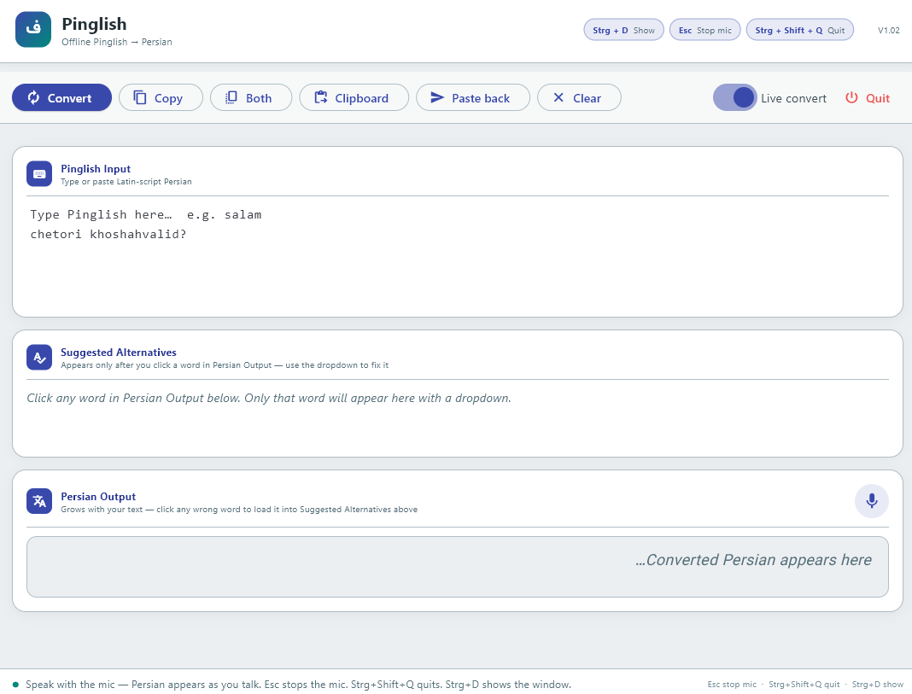
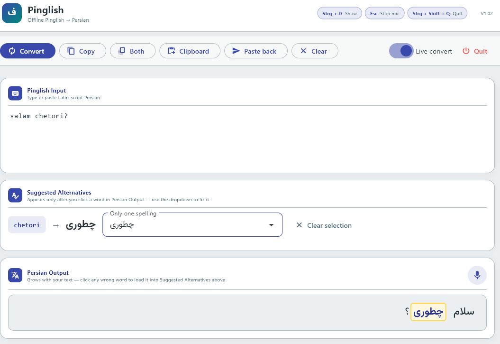
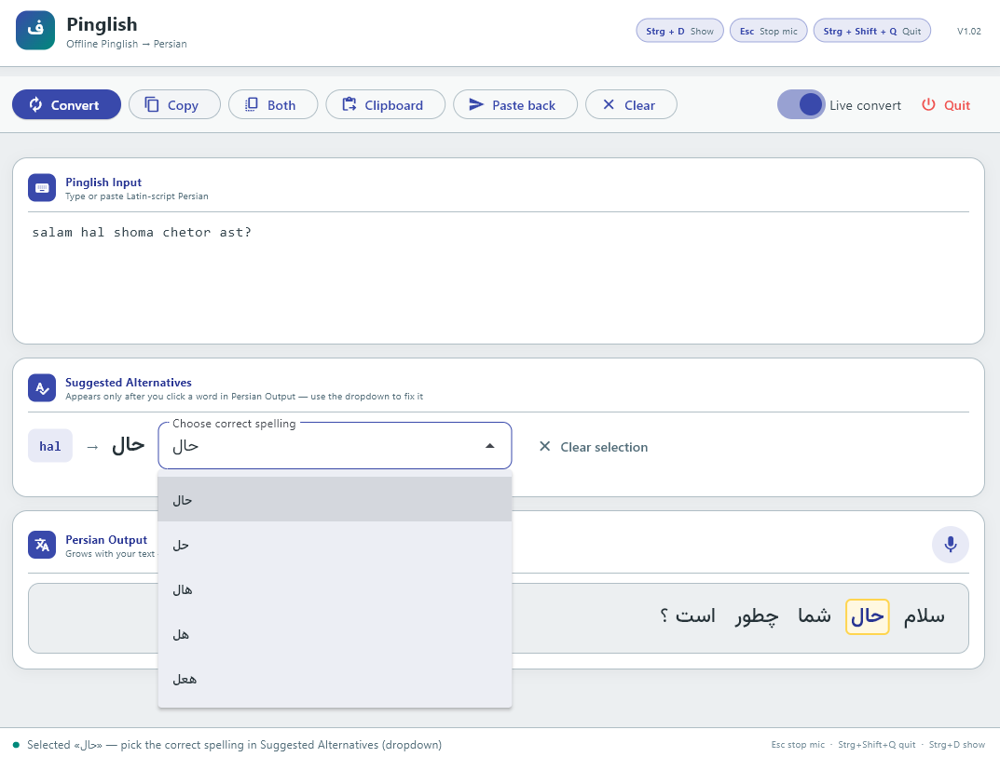

<div align="center">


# Pinglish

**English** | [فارسی](README.fa.md)

**Type Persian in Latin letters, or just speak it, and get proper Persian script.**

A Windows desktop app that converts Pinglish / Finglish (`salam chetori?`) into
Persian (`سلام چطوری؟`) as you type, lets you fix any word from a list of
alternative spellings, and turns spoken Persian into text live.


</div>

---

## Download

<a href="https://apps.microsoft.com/detail/9PLPN1KMX104"></a>

**Recommended: [Pinglish in the Microsoft Store](https://apps.microsoft.com/detail/9PLPN1KMX104)** (Windows 10/11, 64-bit).
Installs with one click, without any security warning, and updates itself.

Or download the installer from GitHub:
**[⬇ Pinglish-Setup-&lt;version&gt;.exe](https://github.com/MindDriverTUWIEN/Pinglish/releases/latest)**.
Run it, click through the setup, and start Pinglish from the Start menu.

No Python or other software is needed. See [Installation](#installation)
for details.

## Screenshots

<p align="center">
  
  <br><em>The app as it opens: Pinglish Input, Suggested Alternatives and Persian Output.</em>
</p>

<p align="center">
  
  <br><em>Typing <code>salam chetori?</code> gives <code>سلام چطوری؟</code> live. Clicking a word shows its spellings.</em>
</p>

<p align="center">
  
  <br><em>Spoken with the mic: <code>salam hal shoma chetor ast?</code> → <code>سلام حال شما چطور است؟</code>, with the alternatives for حال open.</em>
</p>

## Contents

- [Download](#download)
- [Screenshots](#screenshots)
- [Features](#features)
- [Requirements](#requirements)
- [Installation](#installation)
- [Usage](#usage)
- [Speech key](#speech-key)
- [Using your own Google Cloud key](#using-your-own-google-cloud-key)
- [Configuration and data files](#configuration-and-data-files)
- [How it works](#how-it-works)
- [Project structure](#project-structure)
- [Improving the dictionary](#improving-the-dictionary)
- [Building the installer](#building-the-installer)
- [Troubleshooting](#troubleshooting)
- [Privacy](#privacy)
- [Code signing policy](#code-signing-policy)
- [Contributing](#contributing)
- [Credits](#credits)
- [License](#license)

## Features

- **Live conversion.** Persian Output updates on every keystroke.
- **Suggested alternatives.** Click any word in Persian Output to see other
  spellings and pick the right one. Your choice is remembered from then on.
- **Persian punctuation.** `?` `,` `;` become `؟` `،` `؛` in the Persian text,
  while numbers such as `1,000` keep their comma.
- **Speech to text (fa-IR).** Press the mic and speak Persian. Words appear
  while you talk, and each phrase is replaced by the recognizer's final result.
  - Your speech is also written into Pinglish Input as Pinglish
    (`این هدفونی که گرفتی خیلی گرونه` → `in hedfooni ke gerefti kheili gerooneh`),
    so you can keep typing after what you said.
  - Spoken punctuation: say **علامت سوال** for `؟`, **علامت تعجب** for `!`,
    **نقطه** for `.` and **فاصله** for a space.
- **Clipboard tools.** Convert the clipboard, copy the Persian (or both texts),
  or paste the result straight back into the app you were using.
- **Runs in the background.** Closing the window hides it to the system tray.
  A global hotkey brings it back from any program.
- **Taskbar friendly.** Pins as *Pinglish* with its own icon.

## Requirements

- Windows 10 or 11, 64-bit (the app uses WASAPI audio and Win32 window APIs)
- For speech only: a microphone and an internet connection
- Only to run from source: Python 3.11 or newer

## Installation

### For users: Microsoft Store (recommended)

1. Open [Pinglish in the Microsoft Store](https://apps.microsoft.com/detail/9PLPN1KMX104) and click **Get** (or **Install**).
2. Start **Pinglish** from the Start menu.

The Store version is signed by Microsoft, so Windows shows no warning, and it
updates automatically. Windows asks once before Pinglish uses the microphone.
To start Pinglish with Windows, switch it on in **Settings → Apps → Startup**.

### For users: the installer from GitHub

1. Download `Pinglish-Setup-<version>.exe` from the
   [latest release](https://github.com/MindDriverTUWIEN/Pinglish/releases/latest).
2. Run it. It installs for your user account and needs no administrator rights.
   You can add a desktop icon and let Pinglish start with Windows.
3. Start **Pinglish** from the Start menu.

> [!NOTE]
> The installer is not digitally signed, so Windows SmartScreen may show
> *"Windows protected your PC"*. Click **More info → Run anyway**. Each
> release lists the installer's SHA-256 checksum, so you can check the file
> with `Get-FileHash .\Pinglish-Setup-<version>.exe`.

To uninstall, use **Settings → Apps → Installed apps → Pinglish**. Your
corrections and settings in `%LOCALAPPDATA%\Pinglish` are kept.

### For developers: from source

```powershell
git clone https://github.com/MindDriverTUWIEN/Pinglish.git
cd Pinglish

python -m venv .venv
.\.venv\Scripts\Activate.ps1
pip install -r requirements.txt
```

Dependencies are pinned. The UI is written for the Flet 0.85 API, and Flet 1.x
is not compatible.

## Usage

Start the app with one of:

| Launcher | When to use it |
|---|---|
| `launch-hidden.vbs` | Everyday use. No console window. |
| `create-desktop-shortcut.ps1` | Run once to add a desktop shortcut to the launcher above. |
| `run.bat` | Debugging. Shows errors and tracebacks in a console. |
| `python main.py` | From an activated virtual environment. |

The window has three sections, top to bottom:

1. **Pinglish Input**: type or paste Latin-script Persian.
2. **Suggested Alternatives**: empty until you click a word in Persian Output.
   Pick the correct spelling from the dropdown.
3. **Persian Output**: the converted text, with the mic button in its header.

The **Live convert** switch is on whenever the app starts. Turn it off to
convert only when you press **Convert**.

### Keyboard shortcuts

| Shortcut | Action |
|---|---|
| `Ctrl` + `D` (`Strg` + `D`) | Show the window from any program |
| `Esc` | Stop the microphone |
| `Ctrl` + `Shift` + `Q` | Quit completely (the window's X only hides it to the tray) |

### Speaking

Press the mic and wait for the status line to say **Listening on …**. A
Bluetooth headset needs about a second to switch into its call mode. Speak
naturally: a short pause finishes a phrase, and the mic stays on until you
press it again or press `Esc`. The last words before you stop are kept.

## Speech key

Speech recognition sends audio to `www.google.com/speech-api/v2/recognize`
(`fa-IR`), the undocumented endpoint Chrome uses for its own dictation. It is
not Google Cloud's paid Speech-to-Text API.

**Nothing to set up: the mic works right after installation.** The endpoint
only asks for a key parameter, and the app has Chromium's public key built in
(`_DEFAULT_SPEECH_KEY` in `speech_fa.py`). It is the same default key the
open-source [SpeechRecognition](https://github.com/Uberi/speech_recognition)
library uses for `recognize_google()`. It is not linked to your Google account
or anyone else's, so no costs can arise. You need no Google account and no
key of your own.

To use a different key for this endpoint, it overrides the built-in one:

```powershell
# Option 1: a local file that git ignores
Set-Content data\speech_key.txt "another-key"

# Option 2: an environment variable
setx GOOGLE_SPEECH_KEY "another-key"
```

> [!NOTE]
> This endpoint is unofficial. Google publishes no limits or guarantees for it
> and may restrict or switch it off at any time. Then the mic stops working,
> but text conversion is unaffected, and you can switch to
> [your own Google Cloud key](#using-your-own-google-cloud-key).

Text conversion works fully offline.

## Using your own Google Cloud key

If the free endpoint stops working, or you prefer the official service, the app
can use Google Cloud's
[Speech-to-Text API](https://cloud.google.com/speech-to-text) with your own key.
When this key is set, it is always used instead of the free endpoint.

1. In the [Google Cloud console](https://console.cloud.google.com/), create or
   select a project and enable **Cloud Speech-to-Text API**. A billing account
   is required, even for the free quota.
2. Under **APIs & Services → Credentials**, choose **Create credentials → API
   key**. Restrict the key to the Cloud Speech-to-Text API.
3. Add the key in either way, then restart the app:

   ```powershell
   # Option 1: a local file that git ignores
   Set-Content data\google_cloud_key.txt "your-cloud-key"

   # Option 2: an environment variable
   setx GOOGLE_CLOUD_SPEECH_KEY "your-cloud-key"
   ```

To go back to the free endpoint, delete `data\google_cloud_key.txt` or the
variable. If Google refuses your key, the status line shows Google's reason,
for example *API key not valid*.

> [!WARNING]
> **Costs.** Google Cloud includes a free monthly quota of Speech-to-Text
> minutes, then bills per minute of audio; see
> [Google's pricing](https://cloud.google.com/speech-to-text/pricing). While you
> speak, the app sends the growing phrase again for every live update, so the
> billed audio is several times longer than the time you actually speak.
> Set a [budget alert](https://cloud.google.com/billing/docs/how-to/budgets) in
> your project, and never publish your key.

## Configuration and data files

User files are kept in `%LOCALAPPDATA%\Pinglish` when Pinglish is installed,
and in `data/` when it runs from source (ignored by git, except the shipped
dictionary).

| File | Contents |
|---|---|
| `data/community_dict.txt` | Main Pinglish → Persian dictionary (shipped) |
| `data/user_corrections.txt` | Spellings you picked in Suggested Alternatives |
| `data/settings.json` | Hotkey, auto-copy and window size |
| `data/speech_key.txt` | Optional: overrides the built-in free-endpoint key |
| `data/google_cloud_key.txt` | Optional: your own Google Cloud key |
| `data/finglish_launch.log` | Start-up and microphone log for troubleshooting |

## How it works

**Text conversion** works in three layers, and later layers win:

1. The rule and word-frequency engine of [finglish](https://github.com/elektito/finglish)
2. The community dictionary in `data/community_dict.txt` (about 2,700 entries)
3. Built-in patches and your own corrections

**Speech** is captured with `sounddevice` in WASAPI shared mode, preferring a
headset. A small voice-activity gate splits it into phrases; interim and final
results come from the recognizer and are drawn on Flet's event loop as they
arrive. Recognized Persian is turned back into Pinglish by `to_finglish()` in
`converter.py`, which reuses the dictionaries in reverse and checks that each
spelling converts back to the same word.

## Project structure

```text
Pinglish/
├── main.py                    # Flet UI, tray icon, hotkeys, mic wiring
├── converter.py               # Pinglish ⇄ Persian conversion and punctuation
├── paths.py                   # Where resources and user files live
├── speech_fa.py               # Microphone capture and Persian speech recognition
├── community_patches.py       # Hand-curated spellings merged at runtime
├── data/
│   ├── community_dict.txt     # Shipped dictionary
│   └── community_dict_meta.json
├── assets/                    # Icons and the Vazirmatn font
├── docs/screenshots/          # Images used in the README
├── scripts/
│   └── build_community_dict.py
├── launch-hidden.vbs          # Console-free launcher
├── create-desktop-shortcut.ps1
├── run.bat / run.ps1          # Launchers with a console, for debugging
├── installer/                 # pinglish.spec, pinglish.iss, build.ps1
├── build_windows.ps1          # Alternative build with flet build (needs Flutter)
└── requirements.txt
```

## Improving the dictionary

To fix a spelling for yourself, click the word in Persian Output and pick the
right one. To improve it for everyone:

- add a line `finglish<TAB>persian` to `data/community_dict.txt`, or
- add entries to `community_patches.py` or `EXTRA_ENTRIES` in
  `scripts/build_community_dict.py`, then rebuild:

```powershell
python scripts/build_community_dict.py
```

## Building the installer

Needs the source setup above, [PyInstaller](https://pyinstaller.org/) and
[Inno Setup](https://jrsoftware.org/isinfo.php) 6 or 7.

```powershell
.\.venv\Scripts\python.exe -m pip install pyinstaller
.\installer\build.ps1 -Version 1.05
```

This creates `dist\Pinglish\Pinglish.exe` (PyInstaller, with Flet's window
program bundled, so nothing is downloaded at start-up) and the installer
`dist\Pinglish-Setup-1.05.exe`. Upload the installer to a GitHub release
together with its SHA-256 checksum, which the script prints.

## Troubleshooting

| Problem | What to do |
|---|---|
| Typing does nothing | Check that **Live convert** is on, or press **Convert**. |
| The first word you say is missing | Wait for **Listening on …** before speaking. |
| "… sends no sound" | Take the headset out of its case or reconnect it. |
| "Google's free speech service refused the request" | Check your internet connection, or use [your own Google Cloud key](#using-your-own-google-cloud-key). |
| "Your Google Cloud key was refused: …" | Check the key, that the Speech-to-Text API is enabled, and that billing is set up. |
| Nothing appears at start | Run `run.bat` to see errors, and read `data/finglish_launch.log`. |
| An old pin says "Flet description" | Unpin it, start the app, and pin it again. |

## Privacy

- Text conversion runs entirely on your PC.
- When you use the mic, your audio is sent to Google's speech service for
  recognition. Nothing is sent while the mic is off.
- The installer shows this and lets you turn speech recognition off.
- Corrections and settings stay on your PC.

Full text: [Privacy policy](PRIVACY.md).

## Code signing policy

The installer is **not code-signed yet**. Code signing proves who published a
file; without it, Windows SmartScreen shows *"Windows protected your PC"*
(click **More info → Run anyway**). Signing is planned once the project
qualifies for a free open-source certificate or uses a low-cost one.

Until then, you can check that an installer is genuine:

- Installers are built only from this repository's public source code, by the
  GitHub Actions workflow
  [`build-installer.yml`](.github/workflows/build-installer.yml) on
  GitHub-hosted runners.
- Every release lists the installer's SHA-256 checksum. Compare it with
  `Get-FileHash .\Pinglish-Setup-<version>.exe` in PowerShell.
- Download Pinglish only from the
  [releases page](https://github.com/MindDriverTUWIEN/Pinglish/releases) of
  this repository.
- Committers and reviewers: [MindDriverTUWIEN](https://github.com/MindDriverTUWIEN)
- Approvers: [MindDriverTUWIEN](https://github.com/MindDriverTUWIEN)
- Privacy policy: this program does not transfer any information to other
  networked systems unless the user presses the mic button: then the recorded
  speech is sent to Google for recognition, as described in the
  [privacy policy](PRIVACY.md). Speech recognition can be turned off during
  installation.

Details: [docs/code-signing.md](docs/code-signing.md).

## Contributing

Issues and pull requests are welcome. Dictionary fixes are especially useful.
Please describe the Pinglish you typed, what you got and what you expected.

## Credits

- Conversion engine and base word list:
  [elektito/finglish](https://github.com/elektito/finglish) (MIT)
- UI: [Flet](https://flet.dev/)
- Font: [Vazirmatn](https://github.com/rastikerdar/vazirmatn)
  (SIL Open Font License, see `assets/fonts/OFL.txt`)
- Audio: [python-sounddevice](https://github.com/spatialaudio/python-sounddevice)
- Tray and helpers: pystray, Pillow, pyperclip, keyboard, pyautogui

## License

Released under the [MIT License](LICENSE).
